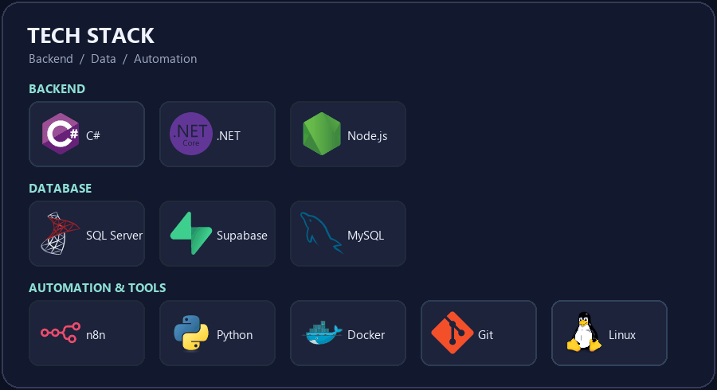

# Hi, I'm Supanut 👋

### Backend Developer · C# / ASP.NET Core · AI Automation

Building practical applications, connecting systems,
and turning repetitive work into useful automation.

---

## 👨‍💻 About Me

I'm an Information Systems graduate focused on **backend development**.
I enjoy designing applications that solve real problems—from working with
databases and APIs to building AI-assisted workflows.

- 🔧 Building with **C#, ASP.NET Core, and SQL Server**
- 🤖 Exploring **RAG, n8n, and workflow automation**
- 🌱 Learning more about **backend architecture and API integration**
- 💼 Interested in **Junior Software Developer** and **Backend Developer** roles

---

## 🚀 Featured Projects

### 🤖 [HR Self-Service Chatbot with RAG](https://github.com/SnowvyTH/Hr-Chatbot)

A co-op project that brings HR self-service to LINE. Employees can ask
questions using a document-based knowledge base and review a confirmation
before submitting a leave request.

`n8n` `LINE Messaging API` `Supabase` `PostgreSQL` `RAG`

### 🏥 [Abnormal Movement Assessment System](https://github.com/SnowvyTH/SeniorProject)

An academic web application for healthcare staff to manage patient records,
complete structured assessments, and generate reports.

`C#` `ASP.NET Core MVC` `Entity Framework Core` `SQL Server`

### 🌱 [Vue & Nuxt 3 Practice](https://github.com/SnowvyTH/Basic-Vue-Nuxt3-with-Prisma-Supabase)

A practice repository for exploring full-stack development with Vue,
Nuxt 3, Prisma, and Supabase.

`Vue` `Nuxt 3` `Prisma` `Supabase`

---

## 🛠️ Tech Stack

Technology icons by [Devicon](https://devicon.dev/).

**Backend & APIs**

**Databases & Data Access**

**Frontend**

**Automation & Tools**

---

## 🏆 A Few Highlights

🥇 **Gold Medal** — National Computer Programming Skills Competition, 2023  
🥈 **Silver Medal** — National Software Innovation Competition, 2024

---

### Let's build something useful together ✨

I'm interested in opportunities to learn, collaborate,
and build software that makes a difference.

📫 **[supanat617@gmail.com](mailto:supanat617@gmail.com)**

